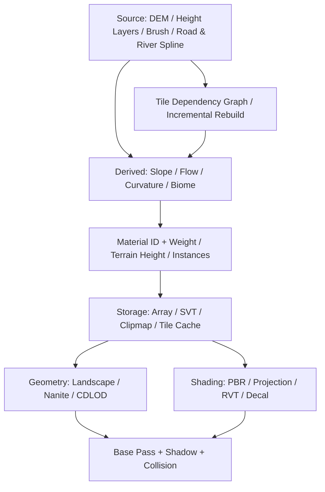

一个开放世界的地形系统，不应该从“选 Landscape 还是 CDLOD”开始讨论。**首先应问：谁拥有高度、道路、材质和植被的原始数据？这些数据在哪一步变成 GPU 纹理？改变一个输入，谁负责重建下游？**

本文是 GDC 地形专题的总览。后四篇依次深入 [Material ID 与混合](/post/gdc-terrain-material-id)、[VT/Clipmap](/post/gdc-terrain-virtual-texture)、[网格与位移](/post/gdc-terrain-geometry)、[笔刷/道路/河流/Decal](/post/gdc-terrain-authoring)。具体代码和浏览器实验属于**独立教学实现**，不是 Ubisoft 或《三角洲行动》的原始源码。


## 一张图先建立全局



这张流程图的七个决策是：**生产、表达、存储与流送、几何、材质合成、物理交互、跨平台与增量构建**。几何与材质是两条并行的消费者，最后在屏幕渲染中汇合。

## 决策 1：源数据不等于贴图

把数据分成三层，是避免未来大规模返工的前提。

| 层 | 典型数据 | 能否重建 |
| --- | --- | --- |
| Authoritative Source | DEM、可编辑 Height Layer、Spline、Brush 参数、Biome Recipe | 不应随意丢失 |
| Derived Data | Slope、Curvature、Flow、Material ID、排除 Mask、植被点 | 理论上由源重新生成 |
| Runtime Cache | 已驻留的 Array Slice、RVT Page、临时 GPU Clipmap | 可以淘汰与重新生成 |

例如道路的权威数据应为中心线、宽度、纵坡、路肩、种子、优先级。对应的道路材质 Mask、地形高度修改、植被排除区域都是**同一份道路输入**的派生结果。

如果只保存道路 Mask，下次想改道路宽度，就必须手动同步多个消费者。Wildlands 的世界生成系统使用道路、水系、村庄等程序化规则驱动下游输出，并强调确定性生成与增量更新，这一点比单个 Shader 更重要。

### 高度至少分成三级

$$
H_\text{visible}=H_\text{macro}+\Delta H_\text{terraform}+D_\text{micro}.
$$

- `H_macro`：山脉、山谷等基础地形高度。
- `ΔH_terraform`：道路、河床、建筑地基和手工 Stamp 等可编辑形变。
- `D_micro`：重复平铺的材质高度，可能只参与 Height Blend，也可能推动真实顶点。

这是数据责任的示意，不意味着三个值始终直接相加。真实的层堆栈可能包含 Replace、Min/Max、权重蒙版、Priority 和非线性混合。尤其要注意：**地表视觉微位移不一定进入 Collision Heightfield**。

## 决策 2：材质如何表达？

| 方案 | 单采样点存储 | 混合发生在哪里 | 工程代价 |
| --- | --- | --- | --- |
| UE Weightmap | 多层连续权重 | Pixel Shader 或 VT 生成阶段 | 通用、容易绘制；材料数大时数据增加 |
| Wildlands 单 ID | 一个 R8 离散材料编号 | 取相邻四 ID，再混合 PBR 属性 | 高压缩率、邻域混合成本 |
| 三角洲双 ID+Weight | 两个 ID + 顶层权重 | 先经离线 ID Fixing，再重建三角形权重 | 支持显式覆盖，需要专用烘焙 |

重要的是 **Splat 是地表材质分布/混合的概念**，并不限定必须用 RGBA 权重。三角洲可以仍使用艺术家在 UE 编辑器里绘制的权重，烘焙为适合运行时的双 ID 编码。

详见下一篇 [143 种材质怎样只绑定少量 Texture Array](/post/gdc-terrain-material-id)，包括单 ID、四邻域、双 ID、三角形三材质交互。

## 决策 3：纹理和 VT 各负责什么？

**不要把 Texture Array、SVT、RVT 和 Clipmap 当成互斥替代品。**

| 机制 | 主要责任 | 常用数据 |
| --- | --- | --- |
| Texture2DArray | 一个资源暴露多个同类型 PBR Slice | Albedo、Normal、ORM、Height |
| Static/Streaming VT (SVT) | 磁盘上的离线页面按需流送 | Vista、远景色、远景高精度法线 |
| Runtime VT (RVT) | 把昂贵地表混合缓存成运行时页面 | 地形 PBR、静态 Decal |
| Clipmap | 围绕观察者维护多级空间数据窗口 | Splat ID、Wetness、Flow 等 |
| 地形 Height Texture | 网格顶点与编辑/碰撞的基础数据 | Macro/Terraform Height |

Clipmap 本身没有规定内容必须是高度还是材质 ID；VT 的重点是页面分配和合成结果缓存。详细讨论与限制见 [第三篇](/post/gdc-terrain-virtual-texture)。

## 决策 4：几何 LOD 与位移拆开选

一个顶点最终在哪、几何有多密、材料微高度从哪里来是三个问题：

$$
P_\text{render}=P_\text{grid}(LOD)+N\cdot D_\text{micro} .
$$

| 路线 | 适用边界 |
| --- | --- |
| UE Landscape | 先得到编辑器、道路、水体、碰撞和 World Partition 工作流 |
| Nanite Landscape | PC 高几何密度与实验性细分，但需要处理额外数据和版本限制 |
| CDLOD / 规则网格 Instancing | 有明确提交、顶点或几何调度瓶颈，值得自定义 Renderer |
| Static Mesh/体素补充 | 洞穴、悬崖反勾、桥洞等无法表达为单值高度的区域 |

三角洲在 GDC 2025 分享的 CDLOD、规则网格和近景软件细分很有参考价值；Wildlands 的微观材质位移是另一条研究轴线。二者不应误写成“CDLOD 天然支持 Material Height Displacement”。第四篇含动态网格实验。

## 决策 5：笔刷是生成器，不只是一次贴图写入

一个河流 Spline 可以生成 `HeightDelta`、`FlowVector`、`Wetness`、`SurfaceID`、`VegetationExclusion` 与水面 Mesh；一个道路 Brush 能同时修改路面、路肩、物理材质和护栏点。

所有生成器应输出受影响的世界 Bounds、依赖列表、混合操作与版本，而不是把最终结果直接烙死。Wildlands 的确定性离线工具和 Frostbite 的对象反向影响地形，正好代表生产工具的两个方向。

## 决策 6：Decal 影响到哪一层？

| 级别 | 输入/结果 | 是否改变真实地形 |
| --- | --- | --- |
| L0 着色贴花 | 颜色、法线、粗糙度 | 否 |
| L1 RVT Composition | 静态材质与贴花合成进 VT | 否 |
| L2 Micro Displacement | 混合微观高度供位移消费 | 可能改变渲染网格，**不自动更新碰撞** |
| L3 Terraform | 写入 Heightfield、更新 Collision | 是 |

例如车辙压低泥土，如果车辆轮胎需要真实压入，就必须让物理高度或局部碰撞也更新。单纯把车辙写进 RVT Height 通道不等于更改 Collision。

## 决策 7：谁负责更新已失效缓存？

修改道路 Spline 后可能影响：`Height -> Slope -> MaterialID -> RVT -> Foliage Exclusion -> Collision -> SVT Build`。这些数据的刷新时机和工具责任要能追踪。

建议每块生成结果带：

```text
TileId
SourceInputHashes
WorldBounds
GenerationVersion
Outputs: Height / ID / Masks / Instances / Collision / VT
```

可变更的编辑层和离线 SVT 必须区分：近景 RVT 更新并不会神奇地把远景已烘焙 SVT 修改掉。动态页面失效也要预算，尤其是车辆高速移动、急转相机和开镜。

## UE5.4 最小原型的合理顺序

先做一个 2 km × 2 km 山谷：Landscape Edit Layers、四种材质、一个道路 Spline 和一条河流。构建可重建的 Height / Material ID / Wetness / Instance 数据。随后验证 Texture2DArray → RVT → 远景静态颜色，再对比 Nanite Landscape 与实例化规则网格。**不要在数据协议尚未稳定时先重写整个地形 Renderer。**

每个实验都应报告输入精度、世界单位、Shader Samples、GPU 时间、显存和质量缺陷；本文没有给出未经测量的性能加速数字。

## 来源与下一篇

- [Ghost Recon Wildlands: Terrain Tools and Technology — GDC 2017 PPT](https://media.gdcvault.com/gdc2017/Presentations/WERLE_MARTINEZ_GRWterrainTechnologyTools.pdf)
- [Delta Force: Performant High-Quality Terrain and Biome Technology — GDC 2025 PPT](https://media.gdcvault.com/gdc2025/Slides/Jiao_Hang_Delta%2BForce%2BPerformant.pdf)
- [Unreal Engine 5.4 Runtime Virtual Texturing](https://dev.epicgames.com/documentation/en-us/unreal-engine/runtime-virtual-texturing-in-unreal-engine?application_version=5.4)

下一篇从一个具体问题开始：**143 种全局材质不需要 143 个 Shader Texture Sample，究竟怎样从 R8 ID 找到 Texture Array Slice？**