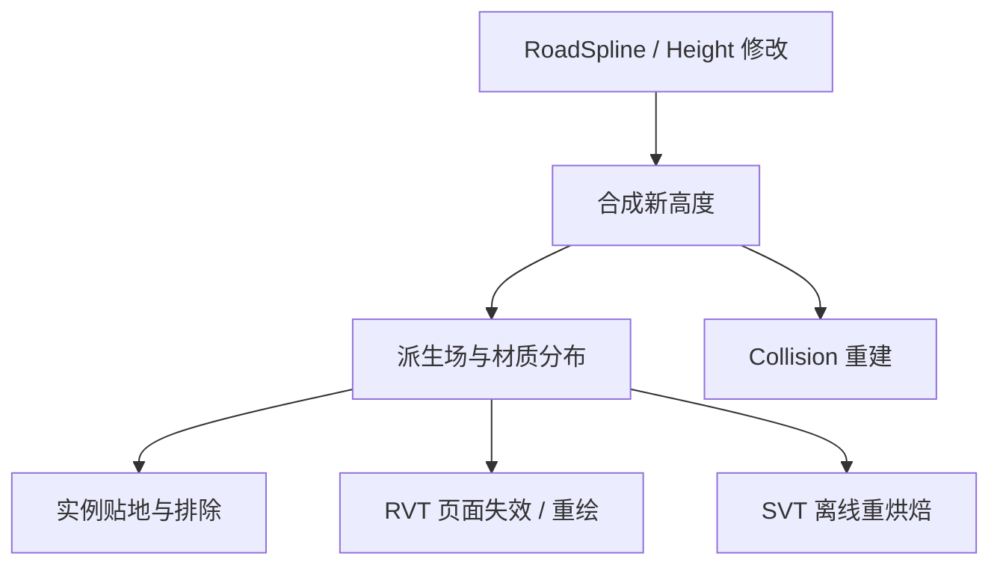

**Wildlands 的生产管线把手工控制留在高度层、规则和曲线里，再用这些输入生成材质分布、道路、Mask 和实例。** 它不是一套从零自动生成最终世界的按钮，也不只是“用 Houdini 撒草”。

本篇按源数据、派生场、工具输出、实例整合和批处理五个层次拆开。先看原项目怎样分工，再用一块可操作的教学地形观察每一步的数据长什么样。与今天 UE 的对应实现分开说明。

## 一、原项目怎样分层，谁负责写入？

Wildlands 演讲第 18–24 页给出的高度层具有明确生产责任：

| 层 | 来源与责任 | 修改方式 |
| --- | --- | --- |
| Base | World Machine 生成的基础高度 | 保留可回退的原始世界形态 |
| Macro | 编辑器内的大形调整 | GPU 高度笔刷、山体 Stamp 等 |
| DCC | Houdini 生成的地形修改 | 道路、铁轨等工具输出的 Terraform |
| Micro | 其他局部关卡设计调整 | 不适合交给前述生成工具的细调 |

**这里的 Micro 是编辑层名。材质中的平铺微观 Height 是另一种数据。** 前者参与世界地形的生产合成；后者用于材质融合或视觉 Displacement。上一版容易将两者并成“微观高度”，这里明确区分。

GPU 笔刷的意义也不仅是速度快：笔刷结果写到可即时显示的高度合成目标，美术能够直接观察游戏里的地形，避免每次在 DCC 与编辑器之间往返导入整个 Mesh。

原演讲第 69–70 页还展示 Houdini 自定义节点选择读取 Base 或所有编辑层。这种接口让工具能明确“基于哪一版地形”计算，而不是从屏幕上抓一张看起来差不多的高度图。

## 二、动画生产台：同一份输入怎样产生不同输出？

<iframe class="article-lab-frame" src="/img/posts/gdc-terrain-authoring/lab.html" title="分层高度、Mask、道路多输出、候选点整合和增量构建动画" loading="lazy" style="width:100%;height:1080px;border:1px solid #40516c;border-radius:12px;"></iframe>

[独立打开生产流程实验](/img/posts/gdc-terrain-authoring/lab.html)。五页依次演示高度层、实际 Mask 图谱、道路生成、实例减法整合和缓存重建。每页可播放、单步或拖动阶段。

先在“分层高度”里逐步前进，观察道路何时出现在 DCC 层；再切到“Mask 图谱”，选坡度、曲率和汇流对比图像。最后修改道路宽度，在“增量重建”中观察各产物依次从陈旧变为有效。

**实验是本文构造的 96×96 高度场。它解释数据关系，不是从 Wildlands 导出的实际资产。** 日照页使用明确标注的法线代理，汇流页使用简化 D8；它们与原项目的完整分析工具有区别。

## 三、规则笔刷到底在刷什么？

Wildlands 的材质分配不是逐像素手绘数百平方公里。其 Settings 包含按顺序评估的规则，例如坡度、高度、噪声和曲率；美术可以绘制整套 Settings，并用程序化条件改变笔刷作用范围。

这包含两个不同的控制量：

1. **规则决定候选输出。** 比如高坡度区域使用岩石，低洼区域采用潮湿泥土。
2. **笔触决定哪里接受这组规则。** 笔刷透明度或区域 Mask 控制规则结果在空间中的应用强度。

因此，把“材质规则”与“最终 Material ID 图”分开保存很有价值。前者是可编辑意图，后者是可重新生成的运行时分布；不能因为运行端只保存一个 ID，就认为美术端也只能绘制整数编号。

可用一个教学表达把接口写清楚：

$$M_{apply}(P)=M_{brush}(P)\,M_{slope}(P)\,M_{noise}(P).$$

这里 $M_{apply}$ 是规则应用范围，不是某一种 PBR 材质的最终全局混合权重。规则栈如何覆盖、保留或替换，仍由具体工具定义。Wildlands 规则堆栈的覆盖逻辑也不能直接当成三角洲双 ID 权重编码。

最终 Material ID、Vista 和高度按 Tile / 四叉树组织，流送到运行时的过程见 [第 02 篇](/post/gdc-terrain-material-id) 与 [第 03 篇](/post/gdc-terrain-virtual-texture)。

## 四、原图中的 Mask 长什么样，分别描述什么？

Wildlands 原演讲并没有把所有衍生数据叫作 Splatting：它单独展示地形粗糙、湿度、日照和水流等字段。

图 1｜第 75 页的技术图局部引用。这里的伪彩色用于观察数据，不能由颜色直接推断实际文件通道。来源：[Benoit Martinez、Guillaume Werlé，GDC 2017](https://media.gdcvault.com/gdc2017/Presentations/WERLE_MARTINEZ_GRWterrainTechnologyTools.pdf#page=75)，© Ubisoft / 原作者。

原图建立“确实存在这些分析场”的证据；下面再把它们拆成可计算的最小模型。动画提供单张大图，方便观察条带、脊线和低洼区域，而不只看缩略图上的颜色。

静态关键帧｜本文实际数组的可视化；蓝色表示本定义下的负曲率，黄色表示正曲率。与上方游戏原图分开标注。

### 4.1 Slope：白色区域为什么沿坡面展开？

在水平采样间距为 $\Delta$ 的 Heightfield 上，用中心差分求斜率：

$$H_x\approx\frac{H(x+\Delta,y)-H(x-\Delta,y)}{2\Delta},\quad H_y\approx\frac{H(x,y+\Delta)-H(x,y-\Delta)}{2\Delta}.$$

基底法线可写成 $N=\operatorname{normalize}(-H_x,-H_y,1)$。坡度角则为 $\theta=\arccos N_z$。坡度场回答“有多陡”，不能单独回答“这是山脊还是凹沟”。

动画为了让高坡区域更容易观察，将梯度长度按教学范围归一化并饱和；它不是以度为单位的真实坡度角。真实工具要声明阈值使用角度、坡比还是归一化值。

### 4.2 Curvature：为什么是细线和凹凸带？

二阶差分可以近似拉普拉斯量：

$$\Delta H\approx\frac{H_L+H_R+H_D+H_U-4H_C}{\Delta^2}.$$

在本坐标定义下，简单碗底为正、山峰为负。动画把负值显示为蓝、正值显示为黄，中间值接近中性。真实地形分析还可以区分 profile curvature、plan curvature 等，不应把所有曲率都等同于这个标量。

曲率适合帮助选择山脊、沉积或凹沟；它对输入噪声和采样尺度敏感。先平滑 1m 与先平滑 10m 得到的结果描述不同尺度地貌，不能只改纹理分辨率而保留同一阈值。

### 4.3 Roughness：不是 PBR Roughness

这里的 Roughness 描述地形起伏或局部不规则程度，可由邻域高度方差、残差或类似量估计。PBR Roughness 则控制微表面的反射分布；两者可以有关联，但不是同一份物理参数。

动画用二阶高度残差幅度做教学代理，因此道路边缘等快速变化区域也会变亮。若要将其用于岩石或植被分布，应先确定检测尺度，避免把采样噪声当成真实碎石区域。

### 4.4 Flow Accumulation：为什么汇成树枝状细线？

最小水文模型可让每个格向最低邻格流出，并把上游累计量传给下游。许多格汇向同一沟槽后，下游值增大，显示为更亮的线。

动画实现了按高度排序的 D8 累积，并用对数映射显示动态范围。它没有做洼地填充、降雨、蒸发和真实河道求解，所以封闭洼地会积累而不继续流出。这是简化边界，不应把生成的每条亮线都宣布为可靠河流。

**Flow Accumulation 与 Flow Velocity 也不同。** 前者是标量汇水量，常用于分布与河道分析；后者是带坐标约定的方向或速度向量，常用于水面运动和特效。

### 4.5 Wetness 与 Sun Exposure：输入未必只来自高度

Wetness 可以综合河流距离、材质、低洼和特定对象。不同消费者可用同一湿度场驱动泥地变暗、岩石湿润和植被分布，但消费者如何映射仍由各自材质或规则定义。

日照分析则需要太阳轨迹、遮挡和时间累计。动画仅显示固定方向的 $\max(0,N\cdot L)$ 代理，因此面朝太阳的坡更亮，背坡更暗；它不包含山体遮挡，也不代表原项目完整的日照时长计算。

这类字段应按**语义、尺度、更新频率和滤波**组织。ID 用离散采样，湿度可连续过滤，水流方向要正确解码；不能为了省一张贴图，就把不兼容数据全部塞进空闲通道。

## 五、道路：路径搜索与地形施工是两个阶段

Wildlands 的道路工具先解决路径选择，再产生可被其他系统消费的结果。原稿第 79 页引用 [Procedural Generation of Roads](https://arches.liris.cnrs.fr/publications/articles/EG2010_ProceduralGenerationOfRoads.pdf)，从更多方向和步长搜索受地形影响的路径。

路径成本需要考虑长度、坡度、转向和障碍。若转弯代价依赖入射方向，搜索状态就不能只保存一个 XY 点；同一点不同进入方向可能具有不同后续成本。本文的中心线动画使用给定曲线，**没有把曲线插值冒充道路寻路算法**。

路径确定后，还要把中心线变成工程输出：

图 2｜第 82 页右侧技术图局部引用；上图是地形施工形状，下图是道路相关材质分布。来源同上，© Ubisoft / 原作者。颜色是可视化，不代表通用 RGBA 协议。

| 输出 | 保存的内容 | 消费者 |
| --- | --- | --- |
| Road Trajectory | 路径、方向及曲线参数 | 道路、交通与导航工具 |
| Terraform | 目标路面及路肩高度影响 | 地形 DCC 编辑层 |
| Splatting | 道路、路肩等材质覆盖范围 | 材质分配与运行时 ID 烘焙 |
| Bridge / 衍生实例 | 桥梁或路边设施描述 | 实例化、资产构建与整合 |

### 中心线距离怎样变成高度和排除区？

设 $d$ 是点到中心线的水平距离，$w$ 为道路全宽，$b$ 为路肩过渡宽度：

$$m(d)=1-\operatorname{smoothstep}(w/2,w/2+b,d).$$

再由曲线纵断面和横断面得到目标高度 $H_{road}$：

$$H'=(1-m)H+mH_{road}.$$

这是本文的教学施工模型。道路材质和植被排除可以从同一距离生成，却未必使用相同宽度：路肩可比行车面宽，植被安全距离还可继续外扩。保留共同源曲线和各输出参数，才能保证修改后一起更新。

“道路多输出”动画显示中心线、宽度区域、高度施工和相关 Mask。调宽道路时三者同步变化；不要只观察一条 Spline Mesh 变宽。

## 六、河流的多输出，比“高度减几米”多了什么？

河道工具需要水位、河床断面、宽深、上下游连续性和汇合约定。河流曲线可以同时导出河床 Terraform、水面网格、湿度、材质、流速方向和排除区。

水文分析与施工之间还存在依赖方向：如果先从基础高度找河流，再用河流挖低地形，应明确“分析输入”和“施工结果”是不同阶段。若每次把结果立即反过来重算源河道，可能形成不稳定循环。

动画蓝线与湿度图共用河道定义；它只解释一条河如何产生多个一致输出，不模拟分叉水动力学。真实水面和 Flow Map 必须继续处理世界坐标、流向、接缝与水位连续性。

## 七、石头和植被：Mask 与点分布是两次不同决策

Wildlands 第 91 页把岩石工具分成分布 Mask 和分布规则。Mask 说明“哪些区域可以或倾向于出现”，分布规则再决定模型、密度、最小间距、尺度和沿坡对齐。

一个教学密度可写成：

$$\rho(P)=\rho_0\,M_{biome}\,M_{slope}\,M_{wetness}\,(1-M_{exclusion}).$$

密度仍不是最终实例。生成器还要用确定 Seed 采样点、检查最小距离和对象占地，并为每点确定资产 ID、变换和相对地形偏移。Seed 稳定有助于局部修改时保留其他点的布局。

动画的“候选点”使用确定 Seed，但为了突出整合次序，没有实现 Poisson Disk 最小间距。不要把其均匀度当作原项目的植被分布品质。

### 为什么原项目强调减法整合？

让道路、聚落、岩石和植被工具互相实时等待，容易形成复杂依赖。Wildlands 采用候选点缓存和后续整合：先让各工具产生点，再贴地并减去冲突区。

演讲第 95 页描述的思路包括保留相对地面偏移、移除道路与河流中的对象，以及对象组之间的排除关系。本文动画依次显示候选 → 减道路 → 减河流 → 减岩石，红叉指出被移除点，最终绿点保留。

静态关键帧｜同一确定 Seed 的教学分布，绿点为最终保留点。

这种做法允许世界在昂贵重算完成前保持可玩。它并不意味着旧点永远正确，也不意味着组间排除顺序可以任意交换：谁优先、谁能删除谁，需要稳定规则。

## 八、Decal 影响的是着色、视觉高度，还是基础地形？

道路、车辙和沉积可能涉及多级数据，不能只用“贴花”一个词覆盖：

| 层次 | 改变什么 | 需要更新什么 |
| --- | --- | --- |
| 表面着色 | Color / Normal / Roughness | 屏幕贴花或对应着色缓存 |
| RVT 合成 | 地面最终 PBR 页面 | 受影响页及其生成依赖 |
| 视觉 Displacement | 材质微观高度 | 几何读取的高度与 Bounds |
| Terraform | 基础 Heightfield | 碰撞、实例贴地、分析场和缓存 |

Wildlands 从屏幕空间 Decal 转向 VT 的动机之一，是让道路细节与位移表面保持一致。对今天的实现，**“写入 RVT”仍不等于自动改变网格**：需要显式把目标高度送进几何位移，或烘焙回基础 Height。

临时枪痕和每帧变化的动态效果，还要衡量页面反复重绘的代价，不应因静态道路受益于缓存，就让所有动态 Decal 都走同一条管线。

## 九、Worldbatch 怎样保持中间数据不过期？

Wildlands 第 75、98 页将地形提交、派生数据更新和 Houdini 批处理关联起来。它把许多分析产物视为可重新生成的中间数据；本文并不把它当作“所有项目都可以不做数据版本管理”的建议。

今天可以保留同样的分层思想，再给产物补上可审查的依赖版本：

图 3｜本文建议的数据依赖模型。箭头表示输入依赖；实例、碰撞、近景与远景产物各自完成，不是改一个 Asset Dirty 标志就全部同步。

“增量重建”动画先把道路源版本加一。六个产物立即显示旧版本，随后依次更新。最后 RVT 已有效而 SVT 仍陈旧的状态尤其重要：它解释了为什么近处已修好，远处仍可能露出旧路。

实际增量范围还要向外扩：差分需要邻域，植被需要排除半径，水流可能影响远处下游。仅取笔刷原始 Bounds 并不总够。

## 十、如何映射到 UE5.4 的现有工具？

| 生产责任 | 可用起点 | 需要自己约定的部分 |
| --- | --- | --- |
| 非破坏性高度 | Landscape Edit Layers / Blueprint Brushes / Patches | 层顺序、合成语义、版本与 Bounds |
| 道路与河道 | Splines / Water / Houdini HDA | 多输出协议、材质和实例排除 |
| 派生 Mask | HDA 或编辑器构建任务 | 尺度、阈值、编码与依赖 |
| 实例分布 | PCG / Foliage / Houdini 点数据 | Seed、最小距离、组间优先级 |
| 缓存 | RVT 与 Streaming Low Mips | 近景失效、离线重烘焙和数据一致性 |

这些是对现有引擎的落地建议，并非 Wildlands 使用了 UE 的这些系统。UE5.4 的功能状态及限制应按对应版本文档验证。

这套管线最有价值的验收场景是：修改一条路后，高度、材质、草点、碰撞与近远景缓存都能追溯到同一个新源版本。画面效果之外，这才是生产工具能够长期维护世界的基础。

## 原始资料

- [Wildlands：Terrain Tools and Technology，GDC 2017](https://media.gdcvault.com/gdc2017/Presentations/WERLE_MARTINEZ_GRWterrainTechnologyTools.pdf)：高度层 18–24 页，规则与笔刷 27–33 页，生产工具 65–98 页。本文局部图引用仅服务技术评论，完整资料归原作者。
- [Wildlands 作者发布页与演示视频入口](https://666uille.wordpress.com/2017/03/08/ghost-recon-wildlands-terrain-tools-and-technology/)。
- [Procedural Generation of Roads，2010](https://arches.liris.cnrs.fr/publications/articles/EG2010_ProceduralGenerationOfRoads.pdf)。
- [Delta Force GDC 2025](https://media.gdcvault.com/gdc2025/Slides/Jiao_Hang_Delta+Force+Performant.pdf)：Biome、Recipe 与跨平台生产的补充对照。
- [UE5.4 Landscape Edit Layers](https://dev.epicgames.com/documentation/en-us/unreal-engine/landscape-edit-layers-in-unreal-engine?application_version=5.4)。
