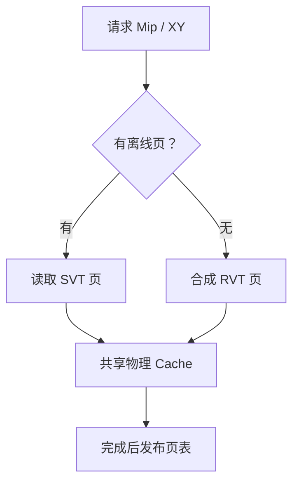

**VT 的关键是地址映射，SVT 与 RVT 决定页面内容从哪里来，Clipmap 决定每级只保留世界的哪一小块。** 要理解这套系统，需要同时看见逻辑地址、物理存储和随相机移动的更新次序。

本文沿着一个实际查询拆解：屏幕像素需要某处地面的细节，系统怎样找到对应的材质和地图片段，又怎样在细数据未到达时保持连续画面。第 02 篇的 Material ID 是内容输入；这里解释它如何抵达页面生成任务。

## 先在动画里走完一次页面请求

<iframe class="article-lab-frame" src="/img/posts/gdc-terrain-virtual-texture/lab.html" title="地形页面流送、Clipmap 条带和动态材质 Array 动画" loading="lazy" style="width:100%;height:1080px;border:1px solid #40516c;border-radius:12px;"></iframe>

[独立打开流送实验](/img/posts/gdc-terrain-virtual-texture/lab.html)。默认暂停；点击“下一步”推进一个阶段，或点击“播放”连续观察。四个主题分别处理页面、Clipmap、材质 Array 和跨 LOD 查询，不需要从材质实验里寻找网格开关。

先观察默认的混合来源：Mip0/1 由 RVT 生成，Mip2/3 从离线 SVT 读取。推进五步后，已填充的槽才会变成绿色、获得页表映射。再点击“快速跨区”，看采样回到父 Mip，而不是读取空槽。实验的世界、页数和延迟是教学参数；本例阈值 2 不是原游戏配置。

## 一、同一个地面位置，为什么会对应五种资源？

以世界位置 $P=(x,y)$ 为例，系统通常需要回答不同问题：

| 资源 | 地址表达的含义 | 内容 |
| --- | --- | --- |
| Height / ID 地图 | 这个世界位置是什么 | 基础高度、材质编号和混合权重 |
| PBR Texture Array | 这是什么材料 | 可重复平铺的颜色、法线、粗糙度、材质 Height |
| ID Clipmap | 当前视点附近有哪些地图数据 | 每个世界 LOD 的局部 ID / Weight 窗口 |
| VT 页表 | 这个虚拟页现在存在哪里 | 逻辑页到物理槽的映射和有效 Mip |
| VT Physical Cache | 这块地面最终看起来怎样 | 已合成的 PBR 结果，包括静态贴花 |

Array 的 Slice 是**材质维度**；VT 的 Page 是**世界空间片段**。一页泥地和另一页泥地可以读取同一个泥土 Slice；一个跨越草、泥和石头的页面则会读取多个 Slice，最终写成一个合成页。不能把两者都叫“纹理缓存”后认为它们共享寻址规则。

Wildlands 的原始图把反馈、地址表和缓存 Atlas 放在一起，解释了为什么逻辑世界可以远大于物理存储：

图 1｜局部引用原演讲第 56 页的技术图；观察中间映射怎样把逻辑区域指向有限 Atlas。来源：[Guillaume Werlé、Benoit Martinez，GDC 2017](https://media.gdcvault.com/gdc2017/Presentations/WERLE_MARTINEZ_GRWterrainTechnologyTools.pdf#page=56)，© Ubisoft / 原作者。下文是本文独立构造的教学模型。

静态关键帧｜本文实验填满本轮需求后的状态；绿色页可用，物理槽标注生产者。即使不播放动画，也可对照逻辑页和物理页。

## 二、VT 的页表：逻辑连续，物理可以打散

假设地图最高分辨率是 $W\times W$，页内有效边长为 $B$。第 $m$ 级的逻辑页网格边长为 $W/(B2^m)$。同一个归一化坐标 $u$ 在该级查询：

$$
n_m=\frac{W}{B2^m},\quad p_m=\lfloor u n_m\rfloor,\quad f_m=\operatorname{frac}(u n_m).
$$

这里 $p_m$ 是 Page 坐标，$f_m$ 是页内位置。页表给出物理槽坐标 $a$，页边界若带 $b$ 个 Border Texel，物理图集宽高为 $A$，则概念上的最终采样坐标是：

$$
UV_{physical}=\frac{a(B+2b)+b+f_m B}{A}.
$$

Border 保存邻页延拓内容，让双线性及一定范围的各向异性过滤不直接读到另一槽的无关数据；具体采样约定还需处理 texel center、导数和 Border 宽度。这个公式描述地址关系，不是 UE 页表的二进制编码。

**不同 Mip 的 Page 具有相同物理纹素数，覆盖的世界面积不同。** Mip 增加 1，同一页覆盖的世界边长翻倍、面积变为四倍。这也是为什么少量粗页可以先覆盖很大的区域。

实验中 `Mip:X:Y` 是逻辑键，右侧“槽 7”才是物理位置。它们之间没有空间相邻保证：世界相邻页完全可以放到图集相隔很远的槽。

### 细页不存在时，不是给 UV 随便加一个 Bias

所需页 $(m,x,y)$ 未驻留时，可以继续查父页：

$$
(m,x,y)\rightarrow(m+1,\lfloor x/2\rfloor,\lfloor y/2\rfloor).
$$

找到父页后，要按父级覆盖范围重新计算页内坐标。否则即使拿到正确物理槽，也会显示错误的地块。本实验固定让最粗父页常驻，并显示“请求键 → 实际命中键 → 槽号”。

真实实现可以在页表里直接缓存可用父级信息，减少逐级查询；动画采用显式向上查找，方便看到地址关系。常驻粗页并不能消除模糊，它解决的是缺页期间的数据有效性。

## 三、一次缺页怎样跨越 CPU、磁盘和 GPU？

把页面生命周期拆成五步，才能解释为什么“已经请求”不等于“已经可采样”。

1. **需求产生。** 屏幕上的地形像素根据世界位置和纹理导数确定目标 Mip，形成 `(Mip,X,Y)`。
2. **反馈压缩。** 收集可见请求并去重；同一页被很多像素访问，不能对应同样多的上传任务。
3. **准备内容。** SVT 读取磁盘里构建好的页；RVT 确认 Height、ID 和 PBR 源可用后，在 GPU 上执行页面材质与贴花合成。
4. **写入物理槽。** 上传或渲染结果，必要时压缩到最终格式；此时不能提前发布映射。
5. **发布映射。** 页面内容完成，页表才允许新查询指向该槽。回收槽时则先撤销旧映射。

动画右侧日志记录的是模型实际发生的操作。将每批预算从 4 改到 1，会看到队列收敛更慢、粗页持续更久。它演示的是调度因果，不把步数换算成真实毫秒。

Wildlands 在第 59–62 页说明了其反馈标记、缺页收集和跨帧生成思路。**这些是自研实现的历史设计，不能直接当作 UE5 的反馈资源布局。** UE 的接口应以当前引擎文档和源码为准。

### 为什么高速驾驶和开镜尤其容易暴露问题？

高速驾驶让新区域持续进入视野，旧页很快离开；FOV 缩小则可能让同一块地面突然需要更细 Mip。两者增加的都是请求峰值，但一个主要改变世界覆盖范围，另一个主要改变屏幕采样密度。

一个简化的预算关系是：

$$
Q_{t+1}=\max(0,Q_t+R_t-U_t),
$$

其中 $R_t$ 是本帧新增且去重后的缺页数，$U_t$ 是本帧完成的页数。长期 $R_t>U_t$ 时队列不可能靠“再等一帧”自动清空；需要减少需求、增加预算或接受更粗回退。

三角洲的开镜处理见原稿第 87 页：通过附加 Mip Bias 抑制短时精度跳升，以画面更软换取过渡稳定。动画的“快速跨区”只演示空间突变，**不声称模拟真实枪械 FOV 和导数变化**。

## 四、SVT 与 RVT 的区别，发生在页面的生产者

| 环节 | SVT | RVT |
| --- | --- | --- |
| 页内容何时算好 | 编辑或构建阶段 | 运行时按需生成 |
| 缺页时主要工作 | 磁盘读取、解码或上传 | 收集绘制对象、材质合成、压缩和写入 |
| 输入依赖 | 离线页文件及其版本 | Height / ID、材质纹理、道路及贴花 |
| 内容修改之后 | 重烘焙对应离线结果 | 使页面失效，再请求重画 |
| 主要风险 | I/O 峰值、旧烘焙结果 | 生成峰值、源数据未驻留、频繁失效 |

它们都可以服务同一个虚拟地址空间。三角洲第 85–86 页展示的关键决策，是把较粗 Mip 的离线结果和较细 Mip 的运行时结果放进**同一物理缓存**，按请求的 Mip 选择生产者。不是先叠一张 SVT，再额外叠一张 RVT 才形成最终画面。

图 2｜据三角洲第 85 页机制重绘。原稿演示的分界 Mip 是它的配置；动画用 Mip2 作教学分界。UE 也有 RVT Streaming Low Mips 的构建流程，但接口、布局和资源限制需要单独核对。

### 远景法线为什么值得离线保留？

把高精度地形的法线烘焙进低分辨率世界材质表示，可以让远处几何变粗后仍保留沟壑的光照。它保住的是着色信息，不会恢复真实轮廓。

进入近景 RVT 时，也必须使用兼容的地形法线定义。若远景存的是“地形基底 + 材质细节”的最终法线，近景却再额外乘一次旧顶点 TBN，便可能产生重复变换与接缝。编码空间、合成次序和解码约定应作为共同数据协议。

## 五、Clipmap：每级固定容量，世界窗口持续滚动

Mipmap 是完整地图的逐级降采样；Clipmap 在每级 Mip 中只保留一个固定大小的局部窗口。假设每级都存 $N=8$ 个纹素，L0/L1/L2 的世界纹素间距分别为 1/2/4 米：

| 级别 | 物理纹素数 | 纹素间距 | 覆盖边长 |
| --- | ---: | ---: | ---: |
| L0 | 8×8 | 1m | 8m |
| L1 | 8×8 | 2m | 16m |
| L2 | 8×8 | 4m | 32m |

这三个窗口同时围绕相机，但必须分别按本级纹素网格对齐。相机走 1m，L0 可能需要更新一列，L1 未必更新，L2 更不必每次更新。

原演讲里的 ID Clipmap 与全场景 Renderer 对应关系如下：

图 3｜局部引用三角洲 GDC 2025 第 96 页；关键是将 ID 地图驻留和场景 Renderer 管理结合。来源：[Hang Jiao 等，Delta Force 技术分享](https://media.gdcvault.com/gdc2025/Slides/Jiao_Hang_Delta+Force+Performant.pdf#page=96)，© 原作者 / 腾讯。图中 Actor 组织是项目决策，不是 Clipmap 的必要定义。

### 环形地址为什么只写边缘，不搬整张纹理？

假设 L0 旧窗口覆盖世界格 `[0,7]`，向右移动一格后覆盖 `[1,8]`。格 1–7 的数据仍然有效，只有世界格 8 对应的新列需要写入。

用环形地址：

$$
p=\operatorname{positiveMod}(worldCell,N).
$$

世界格 8 写到物理格 0，世界格 1–7 仍留在原位置。Shader 依据本级逻辑原点判断有效范围，再用环形地址取值，不能把数组环绕误当成世界本身循环。

二维窗口移动 $\Delta x,\Delta y$，且移动量都小于 $N$ 时，新增纹素数为：

$$
N|\Delta x|+N|\Delta y|-|\Delta x\Delta y|.
$$

减号去掉同时进入新行和新列的重叠角区。大跳跃超过窗口边长时，应重填该级。动画“Clipmap 条带”实际计算新旧矩形差集，并把新增世界格写到对应物理格；黄色条带有时会绕到纹理另一侧。

静态关键帧｜本文实验的一次增量更新，黄色格是新旧窗口差集。

### Clipmap LOD 也必须处理有效性和滤波

两个相邻级别交接时，要知道粗级是否已经到达。连续 Wetness 可在有效区内做平滑混合；Material ID 则不能像颜色那样直接平均编号。ID Clipmap 每级都必须保留合法的离散 ID 和对应权重，跨级过渡时合成材质结果或采用明确的编码策略。

这里讨论的是纹理 Clipmap。GPU Gems 2 第 2 章的 **Geometry Clipmap** 用同类多级窗口组织高度与几何网格；两者共享空间组织思想，但不是把一个开关打开就同时拥有几何和纹理系统。

## 六、动态 Texture Array：相机移动时换的是材料库

全局 ID 图可能包含 32 或更多种材料，局部区域却只用其中几种。动态 Array 把附近需要的高精度材料放进有限 Slice，再用 `GlobalID → LocalSlice` 映射访问。

**ID Clipmap 缺失**是“还不知道这里是什么材料”；**Array 缺失**是“知道材料编号，但高精度材料纹理还没来”；**RVT 缺失**是“输入已知，但最终世界页面还没合成”。三种缺失必须分开诊断。

“动态材质 Array”动画展示三阶段：撤销不再使用的旧映射、写入新 Slice、发布新映射。真实工程还需要引用计数、版本或 Fence，避免页面生成任务在 Slice 换内容时仍读旧地址。已经合成好的 VT 页不必每次继续采样 Array，但重新生成它们仍依赖正确的源材料。

## 七、修改一条道路，为什么近景正确还不够？

道路修改既可能改变材质，也可能改变高度、实例排除及法线。动画提供“修改道路”按钮，撤销模拟缓存里依赖该道路的页；生产系统应按实际相交范围使局部页失效，而不是重建全图。

远景 SVT 是独立的离线产物。如果只重画 RVT，玩家退远后仍可能看到旧道路。应同时记录：源对象版本、受影响 Bounds、近景页失效、远景烘焙 Dirty 状态。源 PBR 材质变化也需要反查依赖它的世界页面。

UE5.4 的 [RVT 官方文档](https://dev.epicgames.com/documentation/en-us/unreal-engine/runtime-virtual-texturing-in-unreal-engine?application_version=5.4) 对 Streaming Low Mips 构建、反馈及 VT 源依赖有限制。不要把所有输入都转成 SVT 后，默认任何 RVT 生成任务和顶点位移都能自动获得正确反馈与驻留保障。

下一篇把数据送到几何阶段：[实例网格、CDLOD 拼接、软细分与材质位移](/post/gdc-terrain-geometry)。

## 原始资料与实验边界

- [Wildlands GDC 2017 原稿](https://media.gdcvault.com/gdc2017/Presentations/WERLE_MARTINEZ_GRWterrainTechnologyTools.pdf)：第 35、40、55–64 页。原图仅局部引用，演讲全文和版权归原作者。
- [Delta Force GDC 2025 原稿](https://media.gdcvault.com/gdc2025/Slides/Jiao_Hang_Delta+Force+Performant.pdf)：第 85–87、95–98 页。
- [GPU Gems 2：GPU Geometry Clipmaps](https://developer.nvidia.com/gpugems/gpugems2/part-i-geometric-complexity/chapter-2-terrain-rendering-using-gpu-based-geometry)：窗口、增量更新与纹理寻址的原始工程解释。
- [UE5.4 Runtime Virtual Texturing](https://dev.epicgames.com/documentation/en-us/unreal-engine/runtime-virtual-texturing-in-unreal-engine?application_version=5.4)。本文没有将 Canvas 调度步数或教学资源配置当成引擎性能实测。
